[English](README.md) · [Português (Brasil)](README.pt-BR.md) · **Español**

Las guías, los prompts, las plantillas y las imágenes canónicas están en inglés.

<a id="top"></a>
<a id="about-the-project"></a>

<p align="center">
  <picture>
    <source media="(prefers-reduced-motion: reduce)" srcset="docs/assets/readme/hero-still.svg" />
    
  </picture>
</p>

# Vibe Coding Toolkit

**Configura tu máquina. Inicia o mejora tus proyectos.**

Un toolkit de **documentación, prompts y plantillas** con **dos funciones: configurar máquinas y configurar proyectos individuales**. Desarrolla con agentes de IA: prepara tu máquina, inicia una aplicación, mejora un proyecto existente y mantén el contexto y la calidad durante todo el trabajo.

Tú describes el objetivo. El agente inspecciona el entorno, organiza las decisiones, configura los componentes aplicables y verifica el resultado. **El código permanece en tu proyecto; este repositorio contiene la receta.**

<p align="center">
  <a href="#start-here"><strong>INICIAR UN PROYECTO →</strong></a>
  &nbsp; · &nbsp;
  <a href="docs/03-environment-setup.md">PREPARAR TU MÁQUINA</a>
  &nbsp; · &nbsp;
  <a href="docs/prompts/12-existing-project-setup.md">CONFIGURAR UN PROYECTO EXISTENTE</a>
  &nbsp; · &nbsp;
  <a href="#full-documentation">EXPLORAR EL TOOLKIT</a>
</p>

<p align="center">
  <a href=".github/workflows/validate.yml"></a>
  &nbsp;
  <a href="LICENSE"><strong>MIT</strong></a>
  &nbsp; · &nbsp;
  <a href="#community">Star History</a>
  &nbsp; · &nbsp;
  <a href="docs/05-toolkit-validation.md">Evidencias y límites</a>
</p>

<p align="center">
  <strong>Claude Code + Codex</strong> / instrucciones portátiles / skills locales
  <br />
  <strong>Next.js</strong> para proyectos nuevos / tu stack se conserva en proyectos existentes
</p>

---

<a id="how-to-use-this-repository"></a>
<a id="how-to-use-this-repo"></a>
<a id="complete-setup-with-the-project-open-in-the-agent"></a>
<a id="choose-your-entry-point"></a>

## 00 / Elige por dónde empezar

| Tu situación | Camino | Qué obtienes |
|---|---|---|
| **Tengo una idea** | [Iniciar un proyecto Next.js](docs/04-project-bootstrap.md) · [Prompt 11](docs/prompts/11-next-project-bootstrap.md) | Producto definido, base oficial, documentación, skills y verificaciones |
| **Ya tengo un proyecto** | [Configurar o actualizar la base](docs/prompts/12-existing-project-setup.md) | Diagnóstico, brainstorming, harness, herramientas y mejoras verificadas |
| **Necesito preparar mi máquina** | [Configuración del entorno](docs/03-environment-setup.md) · [Prompt 10](docs/prompts/10-development-environment-setup.md) | Runtime, agentes, integraciones globales, copias de seguridad y manifiesto |
| **Necesito resolver un problema concreto** | [Instalación modular](docs/01-installation.md) · [Prompts](docs/prompts/README.md) | Lint, refactorización, revisión, contexto o una herramienta específica |

**En esta página:** [Base](#foundation) · [Agentes](#agents) · [Conocimiento](#knowledge) · [Calidad](#quality) · [Prompts](#ready-to-use-prompts) · [Documentación](#full-documentation) · [Comunidad](#community).

El agente debe poder leer archivos, editarlos y ejecutar comandos. Las guías tratan **Claude Code y Codex por separado**; otros clientes pueden seguir los acuerdos con capacidades equivalentes. Una conversación sin acceso al entorno explica el proceso, pero no demuestra instalaciones ni pruebas.

<a id="foundation"></a>

## 01 / Prepara una base que encaje con tu proyecto

<p align="center">
  <picture>
    <source media="(prefers-reduced-motion: reduce)" srcset="docs/assets/readme/foundation-still.svg" />
    
  </picture>
</p>

La configuración empieza por lo que ya existe: producto, archivos, runtime, gestor de paquetes, instrucciones y herramientas disponibles. Los proyectos nuevos reciben una base coherente; los existentes, una adopción compatible con sus contratos.

<a id="start-here"></a>

### Inicia un proyecto con dos líneas

Abre el agente en el directorio de destino y pega el texto. Sustituye la segunda línea por la descripción de tu producto:

```text
Lee https://raw.githubusercontent.com/soumatheusgomes/vibe-coding-toolkit/main/docs/prompts/11-next-project-bootstrap.md y ejecuta la configuración en este directorio.
Proyecto: [nombre, problema, público, flujos principales y restricciones].
```

Ejemplo: «CRM para pequeñas agencias inmobiliarias. Los agentes registran contactos, operaciones y tareas; los responsables siguen el embudo comercial por equipo. Interfaz en inglés, MVP centrado en registrar y seguir oportunidades».

| Área de entrega | Contenido |
|---|---|
| **Producto** | `PRODUCT.md`: problema, público, MVP, restricciones, hipótesis y criterios de aceptación |
| **Aplicación** | Base oficial de Next.js, App Router, TypeScript, Tailwind y ESLint |
| **Servidor y datos** | Drizzle/PostgreSQL para persistencia nueva, Zod, Pino y límites del servidor |
| **Pruebas y calidad** | Vitest, reglas locales, scripts canónicos y validación de la base |
| **Agentes** | Instrucciones compartidas, integración por cliente y skills locales de Vercel |
| **Documentación** | Cuatro archivos en la raíz y cinco documentos en `docs/`, con fuentes y evidencias |

El [bootstrap](docs/04-project-bootstrap.md) termina con una base configurada y la siguiente tarea del MVP identificada. La autenticación, los servicios y las funcionalidades dependen del producto. Una aplicación sin persistencia puede omitir la base de datos con una justificación. Los [valores predeterminados](docs/06-project-defaults.md) se contrastan con fuentes actuales durante la ejecución.

### Configura o actualiza un proyecto existente

Abre el agente en la raíz de la aplicación y pega:

```text
Lee https://raw.githubusercontent.com/soumatheusgomes/vibe-coding-toolkit/main/docs/prompts/12-existing-project-setup.md y ejecuta todo el bloque de la sección “Prompt” en este proyecto, empezando por el brainstorming.
```

El prompt admite una base de código sin el toolkit, una adopción parcial o una configuración antigua. El trabajo sigue este camino:

1. **Comprender:** inspeccionar el producto, el stack, las instrucciones, las dependencias, las integraciones y las verificaciones actuales.
2. **Decidir:** hacer brainstorming y presentar mejoras, riesgos, dependencias y criterios de finalización.
3. **Configurar:** instalar, actualizar, integrar o reutilizar cada componente aplicable del catálogo.
4. **Mejorar:** conciliar documentación y reglas; organizar el código mediante cambios incrementales y verificables.
5. **Verificar:** comparar el antes y el después, probar las integraciones disponibles y registrar límites y tareas pendientes.

**Volver a ejecutar el prompt forma parte del mantenimiento.** Comprueba la revisión del toolkit y la documentación actual, conserva las personalizaciones y evita duplicar instrucciones, skills, hooks o servidores MCP. Se preservan el stack, la base de datos y los contratos existentes; las migraciones incompatibles requieren una decisión propia.

### Prepara tu máquina

```text
Lee https://raw.githubusercontent.com/soumatheusgomes/vibe-coding-toolkit/main/docs/prompts/10-development-environment-setup.md y ejecuta todo el bloque de la sección “Prompt” en este ordenador.
```

La [configuración global](docs/03-environment-setup.md) se ocupa de las herramientas del sistema, Node.js, Docker, agentes, plugins e integraciones. Registra versiones, ámbitos, copias de seguridad, validaciones e intervenciones necesarias. La configuración del proyecto reutiliza este entorno.

> Pega estos textos en una conversación con un agente que tenga acceso al terminal. Los atajos remotos usan la versión publicada en `main`; en una copia de trabajo aún no publicada, usa el archivo local. Ninguna configuración publica automáticamente tu aplicación.

<a id="agents"></a>
<a id="complete-workflow"></a>
<a id="workflow"></a>
<a id="superpowers-first"></a>

## 02 / Orienta el trabajo de los agentes

<p align="center">
  <picture>
    <source media="(prefers-reduced-motion: reduce)" srcset="docs/assets/readme/orchestration-still.svg" />
    
  </picture>
</p>

**Comprender → diseñar → planificar cuando sea necesario → implementar → verificar → revisar.** Cada etapa hace el resultado más predecible. El proceso se adapta al tamaño de la solicitud y a la autorización vigente.

| Función | Herramientas y acuerdos | Cuándo usar |
|---|---|---|
| **Comprender y decidir** | [Superpowers](docs/tools/01-superpowers.md) | Brainstorming, diseño proporcional, planificación, diagnóstico y verificación |
| **Construir dentro del alcance** | [Ponytail full](docs/tools/04-ponytail.md) | Reutilizar lo existente y entregar el menor cambio completo |
| **Comunicar con claridad** | [Caveman](docs/tools/05-caveman.md) | Respuestas concisas; redacción normal en código, documentación y commits |
| **Delegar con responsabilidad** | [Subagentes y oleadas](docs/tools/02-subagent-orchestration.md) | Contexto que puede aislarse, especialización útil y tareas independientes |
| **Reducir la salida repetitiva** | [RTK](docs/tools/03-rtk-token-proxy.md) | Comandos compatibles, conservando el acceso a la salida original |
| **Configurar cada cliente** | [Codex](docs/tools/15-codex-workflow.md) · [Guía práctica de Claude](docs/02-playbook-onboarding.md) | Instrucciones, descubrimiento de skills, servidores MCP y hooks en el formato correcto |

### Capacidad elegida para cada tarea

Con la selección de modelos autorizada, el LLM elige entre los modelos y niveles de esfuerzo realmente disponibles. La búsqueda, el inventario y los cambios mecánicos favorecen capacidades ligeras; las decisiones ambiguas, la seguridad, los datos y la revisión crítica reciben capacidad suficiente para el riesgo.

El [prompt para proyectos existentes](docs/prompts/12-existing-project-setup.md) autoriza esta selección dentro del cliente y la autenticación actuales, respetando las restricciones explícitas. Sin esa política, conserva el modelo de la sesión. La disponibilidad de herramientas no autoriza cambiar de proveedor, activar un proxy ni generar cargos de API.

### Trabajo paralelo cuando las tareas lo permiten

- Cada tarea tiene un objetivo, contexto mínimo, archivos permitidos, dependencias, criterios de aceptación y verificaciones.
- Un escritor por archivo; los lockfiles y las configuraciones compartidas tienen un único responsable.
- Los revisores paralelos trabajan solo en lectura. El coordinador comprueba el diff y la integración.
- Los fallos requieren diagnóstico y posible escalamiento, con límites de tiempo y reintentos.
- Al retomar, se comprueban los archivos, la copia de trabajo y los procesos reales. Un resumen anterior no demuestra el estado actual.

Los cambios pequeños pueden quedarse con el agente principal. El [protocolo de orquestación](docs/tools/02-subagent-orchestration.md) detalla los criterios, la recuperación y la concurrencia.

<a id="knowledge"></a>

## 03 / Haz que el conocimiento sobreviva a la sesión

<p align="center">
  <picture>
    <source media="(prefers-reduced-motion: reduce)" srcset="docs/assets/readme/context-still.svg" />
    
  </picture>
</p>

La **ingeniería de harness** organiza el entorno en el que trabaja el agente: instrucciones fáciles de encontrar, contexto fiable, herramientas accesibles, comandos reproducibles y feedback verificable. El proyecto conserva lo que el siguiente agente necesita para continuar.

| Necesidad | Componente del toolkit | Resultado esperado |
|---|---|---|
| **Saber por dónde empezar** | [AGENTS compartido](templates/AGENTS.md.template) y [puente para Claude](templates/CLAUDE.md.template) | Comandos y restricciones breves que remiten a los detalles |
| **Consultar APIs actuales** | [Context7](docs/tools/12-context7.md) | Documentación de la biblioteca y versión pertinentes, sin enviar secretos |
| **Comprender las relaciones del código** | [Graphify](docs/tools/07-graphify.md) | Grafo consultable con cobertura, actualidad y límites registrados |
| **Conservar decisiones útiles** | [Memoria del cliente](docs/tools/09-claude-memory-system.md) · [Obsidian opcional](docs/tools/08-obsidian-memory.md) | Índice ligero y conocimiento detallado bajo demanda |
| **Usar especialización existente** | [Skills de Vercel](docs/tools/16-vercel-skills.md) · [Skills de artefactos](docs/tools/13-anthropics-skills.md) | Instrucciones pertinentes para la tarea y el cliente, descubiertas y verificadas |

### Cada documento tiene un propósito

El [manifiesto de documentos](templates/project-docs/manifest.json) conecta las plantillas con los nueve destinos del bootstrap:

```text
your-project/
├── README.md                 Cómo empezar y ejecutar
├── PRODUCT.md                Problema, alcance y aceptación
├── AGENTS.md                 Comandos y acuerdos compartidos
├── CLAUDE.md                 Puente a las instrucciones compartidas
└── docs/
    ├── architecture.md       Estructura, límites y decisiones
    ├── design.md             Dirección visual y accesibilidad
    ├── onboarding.md         Preparación local y primer flujo
    ├── quality.md            Verificaciones, revisión y límites
    └── setup.md              Fuentes, versiones, evidencias y pendientes
```

En un proyecto existente, conserva los documentos canónicos equivalentes y registra la correspondencia. Un cambio de comportamiento, comando, esquema o configuración también actualiza el documento responsable. Los detalles permanecen en la fuente correcta sin convertir `AGENTS.md` en una enciclopedia.

### Skills disponibles, acciones bajo demanda

Para Next.js/React, el [catálogo de Vercel](docs/tools/16-vercel-skills.md) cubre buenas prácticas, composición, UI, redacción, transiciones, optimización y operaciones de Vercel, además de `find-skills`. React Native/Expo depende de la plataforma. Los nombres provienen de `SKILL.md` y se comprueban en el proyecto de origen durante la configuración.

Instalar una skill de despliegue no publica. Instalar una skill de transiciones no obliga a usar animaciones. Las skills, los servidores MCP y la memoria externa entran en el flujo cuando existe una tarea pertinente y autorización.

<a id="quality"></a>

## 04 / Sustituye «parece listo» por evidencias

<p align="center">
  <picture>
    <source media="(prefers-reduced-motion: reduce)" srcset="docs/assets/readme/quality-still.svg" />
    
  </picture>
</p>

El toolkit distingue entre **archivo presente**, **configuración completa** e **integración probada**. Cada verificación demuestra una parte del resultado; las tareas pendientes y los fallos preexistentes siguen visibles.

| Área | Cómo verificar | Referencia |
|---|---|---|
| **Estructura y límites** | Presets del framework, reglas locales, límite de 350 líneas e importaciones adaptadas a la base de código | [ESLint y controles de calidad](docs/tools/06-eslint-biome-quality-gates.md) |
| **Comportamiento** | Tipos, pruebas pertinentes, regresiones, manejo de errores y build | [Valores predeterminados del proyecto](docs/06-project-defaults.md) |
| **Interfaz en uso** | Navegación local, teclado, foco, estados, consola, red y rendimiento cuando corresponda | [agent-browser](docs/tools/11-agent-browser.md) · [Chrome DevTools MCP](docs/tools/14-chrome-devtools-mcp.md) |
| **Integraciones del agente** | Descubrimiento real de skills, consultas a Context7, RTK sin duplicación y un grafo pertinente | [Configuración de un proyecto existente](docs/prompts/12-existing-project-setup.md) |
| **Comportamiento del harness** | Tareas desechables para autorización, traspasos obsoletos, revisión sin cambios y recuperación observable | [Evaluación del harness](docs/07-harness-evaluation.md) |
| **El propio toolkit** | Enlaces, anclas, manifiesto, JSON y una base Next.js en un proyecto temporal | [Validación reproducible](docs/05-toolkit-validation.md) |

Las reglas nuevas en código heredado reciben medición y adopción gradual. Las protecciones existentes no se debilitan para obtener un informe en verde. El perfil de lint sigue el stack; instalar reglas no justifica cambiar de ORM ni añadir dependencias que no se usan.

### Revisión después de implementar o corregir

Las instrucciones compartidas ajustan la revisión al **riesgo y la evidencia**. Los cambios relevantes reciben revisión independiente cuando está disponible, cubriendo el diff exacto, los llamadores, contratos y pruebas relacionados.

La revisión termina con los hallazgos relevantes resueltos o con una decisión explícita, las verificaciones afectadas aprobadas y la cobertura y los riesgos residuales registrados. Las rondas adicionales requieren nueva evidencia, riesgo pendiente o una solicitud explícita. Respeta las cantidades solicitadas sin reiniciarlas tras correcciones internas. El [prompt de seguridad](docs/prompts/13-security-review.md) cubre repositorios y diffs, sin modificaciones por defecto y con informes privados.

### Evidencias y límites

La base cuenta con [validación documentada en macOS, Linux y Windows](docs/05-toolkit-validation.md), con verificaciones automatizadas también en [Ubuntu y Windows](.github/workflows/validate.yml). El informe distingue pruebas de límites, SQL, build, HTTP e integraciones reales, y registra avisos de seguridad y límites conocidos. La instalación en otro entorno requiere su propia verificación.

Las verificaciones son explícitas. El toolkit no instala bloqueos de push en `main`, no exige una rama/worktree ni añade hooks de commit/push. Los [hooks del cliente](docs/tools/10-hooks-best-practices.md) usan integraciones compatibles y verificadas, sin duplicación.

<a id="ready-to-use-prompts"></a>
<a id="prompts"></a>

## 05 / Una biblioteca de prompts organizada por objetivos

Elige una tarea, abre el prompt y copia el bloque indicado. El [catálogo completo](docs/prompts/README.md) incluye instrucciones de uso y adaptación.

| Objetivo | Prompts | Cuándo usar |
|---|---|---|
| **Prepararlo todo** | [10 · Máquina](docs/prompts/10-development-environment-setup.md) · [11 · Proyecto nuevo](docs/prompts/11-next-project-bootstrap.md) · [12 · Proyecto existente](docs/prompts/12-existing-project-setup.md) | Instalación inicial, adopción completa o actualizaciones |
| **Comprender y planificar** | [04 · Del brainstorming al plan](docs/prompts/04-brainstorm-to-plan.md) | Convertir una solicitud ambigua en trabajo con criterios de aceptación |
| **Organizar la base de código** | [01 · Limpieza](docs/prompts/01-project-sanitation.md) · [09 · Archivos grandes](docs/prompts/09-file-size-refactor.md) | Medir problemas y refactorizar por responsabilidad |
| **Mejorar el lint** | [07 · ESLint completo](docs/prompts/07-eslint-complete-setup.md) · [08 · Controles de calidad](docs/prompts/08-eslint-quality-gates-install.md) · [02 · Advertencias](docs/prompts/02-eslint-warning-burndown.md) | Instalar reglas, medir código heredado y reducir infracciones |
| **Revisar seguridad** | [13 · Revisión de seguridad](docs/prompts/13-security-review.md) | Repositorio o diff exacto, evidencias e informe privado |
| **Evaluar el harness** | [14 · Evaluación del harness](docs/prompts/14-harness-evaluation.md) | Verificar comportamiento tras configurar o cambiar instrucciones/herramientas |
| **Mejorar el harness** | [15 · Mejora del harness](docs/prompts/15-harness-improvement.md) | Método nativo inspirado en Harness2 por defecto al configurar proyectos nuevos/existentes; laboratorio aislado con CLI oficial opcional |
| **Revisar y coordinar** | [03 · Revisión de código](docs/prompts/03-multi-agent-code-review.md) · [05 · Oleadas paralelas](docs/prompts/05-parallel-wave-dispatch.md) | Revisión especializada y ejecución independiente |
| **Mantener el contexto** | [06 · Memoria](docs/prompts/06-memory-bootstrap.md) | Conservar conocimiento útil sin sobrecargar la sesión |

<a id="eslint-in-one-line"></a>

### Adopta un componente a la vez

Para instalar solo los controles de calidad:

```text
Lee https://raw.githubusercontent.com/soumatheusgomes/vibe-coding-toolkit/main/docs/prompts/08-eslint-quality-gates-install.md y ejecuta el prompt en este proyecto. Usa MAX_LINES=350.
```

Después de medir, el [prompt 09](docs/prompts/09-file-size-refactor.md) guía la refactorización de archivos grandes. Para adoptar solo las skills de Vercel, usa el [catálogo y la instalación local](docs/tools/16-vercel-skills.md). La adopción modular sigue disponible sin ejecutar toda la configuración.

## 06 / Comprende qué pertenece a cada lugar

### Global y local

| Máquina y cliente | Proyecto |
|---|---|
| Runtime, Git y gestor de paquetes | Dependencias de la aplicación y lockfile |
| Agente, autenticación y plugins existentes | Producto, instrucciones y documentación específica |
| RTK e integración funcional | Skills locales y `skills-lock.json` |
| Ponytail, Caveman y Superpowers ya disponibles | Reglas de calidad y comandos canónicos |
| CLI de Graphify y conexión existente de Context7 | Exclusiones del grafo y configuración local cuando sea necesaria |

Claude Code y Codex tienen sus propios mecanismos de descubrimiento y configuración. Reutiliza una integración global que funcione; el contenido personal y las credenciales no se copian en las plantillas. La instalación y las actualizaciones usan el menor ámbito compatible, con límites explícitos de autorización.

### Stack inicial y compatibilidad

| Contexto | Cómo se adapta el toolkit |
|---|---|
| **Proyecto web nuevo** | Next.js estable, App Router, TypeScript, Tailwind, ESLint, Vitest y núcleo de servidor según el producto |
| **Proyecto existente** | Conserva framework, gestor de paquetes, base de datos, ORM, pruebas y equivalentes funcionales; mide antes de cambiar |
| **Monorepo** | Identifica workspaces, límites y configuraciones compartidas antes de seleccionar destinos |
| **Otro cliente o stack** | Usa capacidades y formatos compatibles; registra los componentes no aplicables y los bloqueos |
| **Sin credenciales ni servicios** | Ejecuta verificaciones seguras e independientes; distingue configuración de integración real |

El toolkit no es un generador propio ni una aplicación lista para usar. Las nuevas estructuras iniciales provienen de `create-next-app`; las plantillas complementan la base. Las versiones y APIs se comprueban durante la configuración. La publicación, los servicios de pago y las migraciones incompatibles requieren la autorización correspondiente.

<a id="full-documentation"></a>
<a id="complete-documentation"></a>
<a id="index"></a>
<a id="references"></a>

## 07 / Explora la documentación

```text
vibe-coding-toolkit/
├── README.md                 Estás aquí
├── docs/                     Guías, valores predeterminados y evidencias
│   ├── tools/                Herramientas por finalidad
│   └── prompts/              Recetas para copiar
├── templates/                Archivos para adaptar en el destino
└── scripts/                  Validación del toolkit
```

<a id="fundamentals"></a>

### Guías

| Documento | Finalidad |
|---|---|
| [Visión general](docs/00-overview.md) | Principios y caminos de adopción |
| [Instalación](docs/01-installation.md) | Comandos, distribución y ámbitos |
| [Guía práctica de Claude](docs/02-playbook-onboarding.md) | Un flujo de proyecto explicado paso a paso |
| [Configuración de la máquina](docs/03-environment-setup.md) | Preparación, reanudación y reproducción del entorno |
| [Bootstrap de Next.js](docs/04-project-bootstrap.md) | De la descripción del producto a una base configurada |
| [Proyecto existente](docs/prompts/12-existing-project-setup.md) | Adopción completa, actualizaciones y harness |
| [Validación del toolkit](docs/05-toolkit-validation.md) | Qué se verificó y qué límites permanecen |
| [Valores predeterminados del proyecto](docs/06-project-defaults.md) | Stack, documentación y criterios de adaptación |

### Herramientas

El [catálogo de herramientas](docs/tools/README.md) mantiene el índice completo, los enlaces de instalación y la [matriz de ámbito de máquina/proyecto](docs/tools/README.md#select-by-scope).

| Capacidad | Cuándo usar |
|---|---|
| [next-dev-loop / next-bundle-optimizer](docs/tools/17-nextjs-runtime-and-performance.md) | Un proyecto Next.js compatible necesita feedback de ejecución o análisis de bundles |
| [Guía PostgreSQL](docs/tools/18-postgresql-skills.md) | Trabajo en SQL, esquemas, migraciones, conexiones o seguridad de la base de datos |
| [Reparación de CI en GitHub](docs/tools/19-github-ci-repair.md) | Investigar checks de PR que fallan en GitHub Actions |
| [Revisión diferencial de seguridad](docs/tools/20-security-review.md) | Un cambio afecta datos sensibles o límites de confianza |
| [shadcn](docs/tools/21-shadcn-ui.md) | El proyecto usa o elige shadcn/ui |
| [Sentry MCP](docs/tools/22-sentry-mcp.md) | Investigar errores y rendimiento de un servicio elegido con acceso autorizado |
| [Harness2](docs/tools/23-harness2.md) | Comparar cambios del harness con evidencia, distinguiendo adaptación nativa, demo oficial y resultados de benchmarks |

Evalúa todas las opciones durante la configuración; activa las que sirven al proyecto. Cada guía cubre requisitos, instalación, uso, verificación y mantenimiento.

### Plantillas

El [catálogo de plantillas](templates/README.md) incluye documentación, núcleo Next.js, perfiles ESLint, configuración de Context7 por cliente, exclusiones de Graphify y ejemplos de hooks. Copia y adapta solo los archivos que uses; valida en el destino. El [manifiesto](templates/project-docs/manifest.json) es la referencia para los documentos generados.

### Verifica esta copia de trabajo

```bash
node --test scripts/validate-docs.test.mjs
node scripts/validate-docs.mjs
node scripts/validate-next.mjs
```

Los primeros comandos prueban el validador y comprueban enlaces, anclas, destinos y JSON. El último requiere **Node.js 24, npm y acceso a la red**; crea un proyecto temporal, ejecuta las verificaciones de la base y elimina los recursos creados. Las dependencias del producto quedan fuera de la raíz de este repositorio. Consulta el [alcance y las evidencias](docs/05-toolkit-validation.md) antes de interpretar los resultados.

<a id="community"></a>

## 08 / Sigue el progreso del proyecto

Si el toolkit te ayudó a preparar un proyecto o mejorar tu flujo de trabajo, una estrella facilita volver a encontrarlo y ayuda a otras personas a descubrirlo.

<a href="https://www.star-history.com/?repos=soumatheusgomes%2Fvibe-coding-toolkit&amp;type=date">
  <picture>
    <source media="(prefers-color-scheme: dark)" srcset="https://api.star-history.com/chart?repos=soumatheusgomes/vibe-coding-toolkit&amp;type=date&amp;theme=dark" />
    <source media="(prefers-color-scheme: light)" srcset="https://api.star-history.com/chart?repos=soumatheusgomes/vibe-coding-toolkit&amp;type=date" />
    
  </picture>
</a>

[Abrir el historial de estrellas](https://www.star-history.com/?repos=soumatheusgomes%2Fvibe-coding-toolkit&type=date) · [Informar de un problema](https://github.com/soumatheusgomes/vibe-coding-toolkit/issues) · [Sugerir una mejora](https://github.com/soumatheusgomes/vibe-coding-toolkit/pulls)

El gráfico lo proporciona [Star History](https://www.star-history.com/blog/how-to-use-github-star-history/) y depende de la disponibilidad de ese servicio. Para contribuir, describe el problema, mantén las rutas públicas en inglés e incluye la validación pertinente. Los prompts y las plantillas deben seguir siendo portátiles, sin secretos ni configuraciones personales.

<a id="credits"></a>
<a id="license"></a>
<a id="build-together"></a>
<a id="acknowledgments"></a>
<a id="licensing"></a>

## Créditos y licencia

Basado en [Superpowers](https://github.com/obra/superpowers), [RTK](https://github.com/rtk-ai/rtk), [Ponytail](https://github.com/DietrichGebert/ponytail), [Caveman](https://github.com/JuliusBrussee/caveman), [Graphify](https://github.com/Graphify-Labs/graphify), [Context7](https://github.com/upstash/context7), [agent-browser](https://github.com/vercel-labs/agent-browser), [Vercel Agent Skills](https://github.com/vercel-labs/agent-skills) y [Skills CLI](https://github.com/vercel-labs/skills). Cada proyecto mantiene su propia licencia y distribución.

Toolkit bajo licencia [MIT](LICENSE). Por [Matheus Gomes](https://instagram.com/matheusgomes).

<p align="center">
  <strong>CONSTRUYE CON INTENCIÓN. ENTREGA CON FLUIDEZ.</strong>
  <br />
  <a href="#top">Volver arriba ↑</a>
</p>
